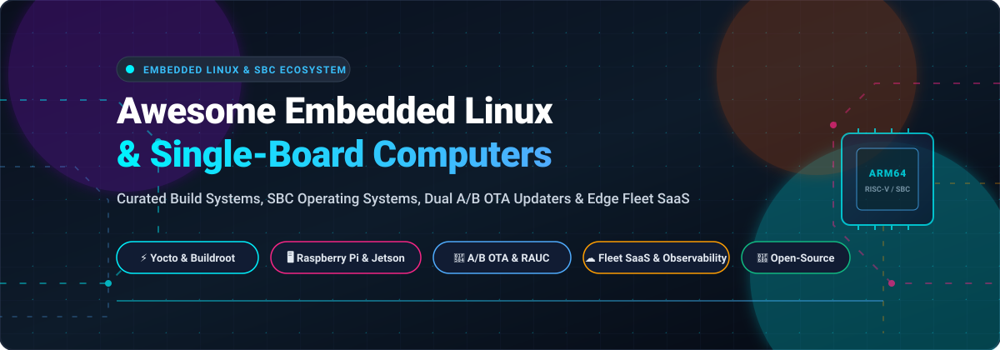

# Awesome-Embedded-Linux-Single-Board-Computers


  





  
  
  
  
  



# 🖥️ Top Embedded Linux & Single-Board Computers

**Curated List of SaaS Products & Open-Source GitHub Projects**  
*Focused on Embedded Linux Build Systems, SBC Operating Systems, OTA Firmware Updates, Fleet Management & Edge Hardware Tooling*  
**Last updated: November 2026**

This repository tracks notable **SaaS platforms** and **open-source projects** for **Embedded Linux & Single-Board Computers (SBCs)**. These tools power custom embedded Linux distributions (`Yocto`, `Buildroot`, `Armbian`), A/B over-the-air (OTA) firmware updates, remote SSH/VPN device fleets, hardware observability, and Raspberry Pi / NVIDIA Jetson / BeagleBone / RISC-V SBC automation for embedded engineers, IoT developers, and hardware startups.

**Examples** include AWS IoT Greengrass, Azure IoT Edge, JFrog Connect (Upswift), Edge Impulse (Qualcomm), Particle Cloud, BalenaCloud, Mender (Northern.tech), Memfault, Toradex Cloud (Torizon), and Upswift (the category leaders).

**🚀 Open-source emphasis**: This section is heavily expanded with every major active project for embedded Linux build systems (`Yocto Project`, `Buildroot`, `OpenWrt`, `Armbian`, `DietPi`), open-source OTA update engines (`Mender`, `RAUC`, `SWUpdate`, `OSTree`), bootloaders (`U-Boot`), and SBC utilities (`oh-my-pi`, `rpi-imager`, `Home Assistant OS`, `Klipper`) — ideal for firmware engineers, hardware hackers, and industrial IoT teams seeking zero vendor lock-in.

🤝 Contributions welcome! Open a PR to add/update entries. Keep descriptions factual and link to official sites.

## 📑 Table of Contents
- [📊 Sector Overview & Market Dynamics](#-sector-overview--market-dynamics)
- [☁️ SaaS/Hosted Platforms](#️-saashosted-platforms)
- [💻 Open-Source GitHub Projects](#-open-source-github-projects)
- [🛠️ How to Contribute](#️-how-to-contribute)
- [⚠️ Disclaimer](#️-disclaimer)
- [💖 Support & Thank You](#-support--thank-you)

## 📊 Sector Overview & Market Dynamics

The global Embedded Linux and Single-Board Computer (SBC) ecosystem spans a **$4.2B–$5.5B+ SBC hardware market** and a **$14B–$18B+ Embedded OS & IoT Device Management software market in 2026**, growing at ~10%–14% CAGR on the back of industrial edge AI, robotics, and ARM/RISC-V adoption. The software layer is **moderately fragmented** across hyperscaler IoT runtimes (AWS/Azure), specialized OTA/observability vendors (Balena, Mender, Memfault), and hardware-tied clouds (Toradex, Particle), while the underlying build and OS foundation is **heavily consolidated around open-source standards** like the Linux Kernel, Yocto, Buildroot, and U-Boot.

## ☁️ SaaS/Hosted Platforms

*Sorted descending by company valuation / annual revenue scale.*

| Platform | Description | Company Scale (Valuation / Revenue) | Starting Paid Tier | Free Tier / Trial Limit |
| :--- | :--- | :--- | :--- | :--- |
| **[AWS IoT Greengrass](https://amazon.com)** | Managed cloud-edge runtime enabling Linux SBCs and gateways to execute local Lambda functions, Docker containers, and ML inference offline. | **Part of Amazon / AWS** (~$115B+ AWS annual revenue; ~$2T+ parent market cap) | **~$0.16 / device / month** (plus AWS IoT Core messaging/shadow usage fees) | **12-Month AWS Free Tier** (Up to 3 connected Greengrass core devices and 250,000 IoT Core messages/month free) |
| **[Azure IoT Edge](https://microsoft.com)** | Microsoft's cloud-managed runtime deploying containerized modules, Azure AI models, and telemetry pipelines onto Linux and Windows edge SBCs. | **Part of Microsoft Azure** (~$85B+ Azure cloud revenue; ~$3T+ parent market cap) | **$10 / month** (Azure IoT Hub S1 basic unit for 400,000 messages/day) | **Forever Free IoT Hub F1 Tier** (Up to 500 registered devices and **8,000 messages/day** free; 30-day $200 Azure credit) |
| **[JFrog Connect (formerly Upswift)](https://jfrog.com)** | Cloud-native Linux and IoT device management platform providing OTA software updates, remote SSH/VNC access, and real-time fleet monitoring. | **Part of JFrog Ltd.** (~$430M+ annual revenue; ~$3.5B–$4.5B public market cap) | **Usage / Enterprise Contract** (Bundled with JFrog Platform; ~$40–$98/mo starting Artifactory/Connect tiers) | **Forever Free Sandbox / Trial** (Up to **5 connected Linux devices** free for evaluation and testing; 14-day full enterprise trial) |
| **[Edge Impulse (Qualcomm)](https://edgeimpulse.com)** | Cloud ML engineering platform for training, quantizing, and deploying low-latency computer vision and sensor AI models onto Linux SBCs and MCUs. | **Acquired by Qualcomm** (~$150M+ est. acquisition scale; ~$39B+ Qualcomm parent revenue) | **$20 / month** per developer seat for Professional plan (Enterprise custom) | **Forever Free Developer Plan** (Unlimited projects, 20 minutes job compute limit, 4 GB storage, and full C++/Linux SDK exports) |
| **[Particle Cloud](https://particle.io)** | Integrated IoT hardware-to-cloud platform offering OTA firmware updates, cellular/Wi-Fi connectivity, and fleet diagnostics for Linux gateways and MCUs. | **~$150M–$250M Est. Valuation** (~$30M–$50M est. ARR; $90M+ VC funding) | **$49 / month** (or pay-as-you-go Growth blocks starting at $299/mo for 100+ devices) | **Forever Free Sandbox Tier** (Up to **100 devices** and 100,000 data operations/month free with no credit card required) |
| **[balenaCloud](https://balena.io)** | Container-based fleet management SaaS for Raspberry Pi, Jetson, and industrial SBCs featuring delta image updates, remote VPN, and balenaOS. | **~$100M–$150M Est. Valuation** (~$15M–$25M est. ARR) | **$119 / month** for Pilot plan (supports up to 100 devices; $2.00/device/mo thereafter) | **Forever Free Tinker Plan** (Up to **10 devices** free forever with full container push, remote SSH terminal, and public URLs) |
| **[Toradex Cloud (Torizon)](https://toradex.com)** | Industrial embedded Linux platform and cloud OTA service built around Yocto/OSTree for Toradex System-on-Modules (SoMs) and ARM SBCs. | **~$80M–$120M Est. Revenue** (Established Swiss industrial embedded hardware/software vendor) | **~$350 / month** for Torizon Cloud Team plan (scales by fleet size) | **Forever Free Evaluation Tier** (Up to **5 devices** free with secure OTA updates, fleet monitoring, and remote access) |
| **[Memfault](https://memfault.com)** | Embedded observability, crash-analytics, and OTA release management SaaS for Linux SBCs, Android AOSP, and RTOS devices. | **~$100M+ Est. Valuation** (~$35M+ Series B VC funding) | **~$250–$500 / month** indicative starting startup/team tier (custom volume pricing) | **14-Day Guided Free Trial / Sandbox** (Limited evaluation device quota for testing core dumps, metrics, and OTA cohorts) |
| **[Mender (`Northern.tech`)](https://mender.io)** | Enterprise hosted OTA software update manager supporting robust A/B rootfs rollback, delta updates, and remote terminal on Yocto/Debian SBCs. | **~$50M–$80M Est. Valuation** (Part of Northern.tech; ~$15M+ group ARR) | **$32 / month** for Mender Starter (includes first 10 devices; $0.60–$1.50/device/mo add-on) | **12-Month Free Trial** (Up to **10 devices** free for 12 months with full A/B OTA updates and remote terminal) |
| **[Upswift (Legacy Standalone / JFrog Connect)](https://jfrog.com)** | Lightweight cloud agent for Raspberry Pi and Ubuntu/Yocto SBCs providing micro-OTA updates, remote port forwarding, and hardware alerts. | **Acquired by JFrog** (~$15M–$25M acquisition scale) | **Merged into JFrog Connect** (Starts at **$0–$40/mo** entry tier) | **Forever Free 5-Device Tier** (Up to **5 Linux SBCs** free forever for remote terminal and OTA script deployments) |

## 💻 Open-Source GitHub Projects

| Project | License / Hosting Cost | Free Tier / Self-Hosted Limit | Description |
| :--- | :--- | :--- | :--- |
| **[Oh My Pi (`can1357/oh-my-pi`)](https://github.com)** | **Open-Source** ($0 CLI/config toolkit for Raspberry Pi & Linux SBCs) | **100% Free forever** (Unlimited SBC setups, shell customizations, and automated Raspberry Pi workflows) | Opinionated open-source configuration and productivity toolkit built to streamline Raspberry Pi and embedded Linux SBC setup and daily workflows. |
| **[The Yocto Project (`yoctoproject/poky`)](https://github.com)** | **MIT / GPL-2.0 Open-Source** ($0 build system & reference distro) | **100% Free forever** (Unlimited custom embedded Linux images, BSP layers, SDKs, and reproducible builds on local hardware) | The industry-standard Linux Foundation build framework for creating custom, production-grade embedded Linux distributions across ARM, x86, and RISC-V. |
